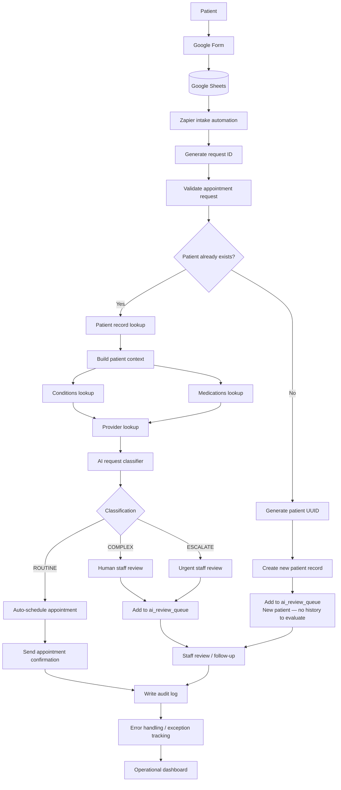

# AI-Powered Healthcare Appointment & Care Coordination System Flowchart Diagram

This flowchart diagram documents the workflow described in the project README. It distinguishes the new-patient path from the returning-patient path and keeps human review in the loop for complex or escalated requests.

## Responsibility split

- **Google Form:** patient-facing appointment request intake.
- **Google Sheets:** stores submitted intake data and structured patient/provider records.
- **Zapier:** starts the intake automation, assigns a request ID and coordinates the initial validation steps.
- **Patient lookup and UUID generation:** identifies returning patients or creates a unique ID and record for a new patient.
- **Context lookup:** retrieves available patient conditions and medication information for returning patients, then looks up suitable provider context.
- **AI classifier:** classifies requests as ROUTINE, COMPLEX or ESCALATE to support administrative routing.
- **Appointment scheduling:** handles routine, low-complexity requests automatically.
- **Human review queue:** sends complex, escalated and new-patient cases for staff attention.
- **Notifications and audit trail:** communicates outcomes and records workflow activity for operational tracking.
- **Error handling and dashboard:** supports exception tracking and workflow monitoring.

## Important workflow boundary

The AI classification is administrative decision support, not a clinical diagnosis or a substitute for professional medical judgment. New patients are placed in the review queue because there is no existing patient history to evaluate.
